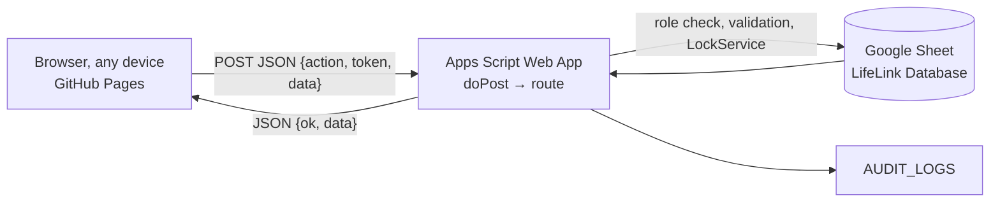

# LifeLink – Smart Transfusion & Monitoring System

Static front end (GitHub Pages) → Google Apps Script API → Google Sheets database.
No record is stored in the browser, so data syncs across every device.

## Folder structure
```
lifelink/
├── index.html
├── css/style.css
├── js/config.js          ← the ONLY line you edit (API_URL)
├── js/app.js
├── apps-script/
│   ├── Code.gs           ← paste into Apps Script
│   └── appsscript.json   ← manifest (paste too)
└── README.md
```

## Data flow


## Step 1 – Create the spreadsheet
1. Go to https://sheets.google.com and click **Blank spreadsheet**.
2. Leave the name; `setup()` renames it **LifeLink Database**.

## Step 2 – Add the backend and run setup()
1. In the spreadsheet click **Extensions → Apps Script**.
2. Delete everything in `Code.gs` and paste the full contents of `apps-script/Code.gs`. Press **Ctrl+S**.
3. Click the gear icon (**Project Settings**), tick **Show "appsscript.json" manifest file in editor**. Go back to **Editor**, open `appsscript.json`, replace its contents with `apps-script/appsscript.json`, and save.
4. In the function dropdown choose **setup** and click **Run**. Click **Review permissions**, choose your account, **Advanced → Go to project (unsafe) → Allow**. (The "unsafe" warning appears because you wrote the script yourself.)
5. A dialog (and the **Execution log**) shows the **admin password**. Username is `lifelinkadm`. Copy the password now. Run `resetAdminPassword` any time to get a new one.
6. Optional demo data: choose **seedSampleData** and click **Run**. (Reloading the spreadsheet also adds a **LifeLink** menu with the same items.)

## Step 3 – Deploy the Web app
1. Click **Deploy → New deployment**.
2. Click the gear next to "Select type" and choose **Web app**.
3. Description: `LifeLink v1`. **Execute as: Me**. **Who has access: Anyone**.
4. Click **Deploy**, then **Copy** the **Web app URL** (it ends in `/exec`).
5. After any later code change: **Deploy → Manage deployments → pencil icon → Version: New version → Deploy**. The URL stays the same.

## Step 4 – API_URL: the exact location
Open **`js/config.js`**. It has one line:
```js
const API_URL = 'https://script.google.com/macros/s/PASTE_YOUR_DEPLOYMENT_ID_HERE/exec';
```
Replace the whole text between the quotes with the URL you copied. Do not change anything else. If it is not set, the app shows "API_URL is not set" instead of failing silently.

## Step 5 – GitHub Pages
**Browser method**
1. Sign in at https://github.com and click **New repository**. Name it `lifelink`, set **Public**, click **Create repository**.
2. Click **uploading an existing file**. Drag in `index.html`, the `css` folder and the `js` folder (including your edited `config.js`). Click **Commit changes**.
3. Open **Settings → Pages**. Under **Build and deployment** choose **Deploy from a branch**, branch **main**, folder **/ (root)**, click **Save**.
4. Wait about 1 minute, then open `https://<your-username>.github.io/lifelink/`.

**Git method**
```bash
cd lifelink
git init && git add index.html css js README.md
git commit -m "LifeLink"
git branch -M main
git remote add origin https://github.com/<your-username>/lifelink.git
git push -u origin main
```
Then do step 3 above.

## Sample data (seedSampleData)
Donor password `Donor@1234`, hospital password `Hospital@1234`. IDs are created in order.

| ID | Record |
|---|---|
| LLD00001–LLD00006 | Aisha Rahman O-, Omar Haddad A+, Priya Nair B+, Khalid Mansoor O+ (donated 10 days ago, still recovering), Fatima Alzaabi AB-, Rahul Mehta A- |
| LLH00001 | Dubai Central Hospital (government, blood bank) |
| LLH00002 | Sharjah Community Clinic (private) |
| LLP00001–LLP00004 | Layla Hassan O- (HLA close to donor 1), Youssef Karim A+ (child), Maria Santos B+, Hamad Alshamsi AB- (last one at LLH00002) |
| UNT00001–UNT00009 | 9 inventory lines, including units expiring in 3–4 days and one already expired |
| EMG00001–EMG00004 | CRITICAL, HIGH, MODERATE and LOW cases |

Try it: sign in as `LLH00001`, open **HLA match**, choose Layla Hassan.

## Exact sheet headers (row 1 of each tab, created by setup())
```
DONORS:           DonorID FullName Height Weight DateOfBirth Age EmiratesID IDName Phone Gmail Password BloodGroup RegistrationDate Status EmergencyLock LifetimeDonations EmergencyDonations ReliabilityScore RareBloodPoints SafetyPoints CommunityPoints ExcellenceScore RewardRank
HLA_DONORS:       DonorID HLA_A1 HLA_A2 HLA_B1 HLA_B2 HLA_C1 HLA_C2 HLA_DR1 HLA_DR2
HOSPITALS:        HospitalID HospitalName LicenseNumber Email Phone Address City HospitalType BloodBankAvailable EmergencyContact Password RegistrationDate
PATIENTS:         PatientID FirstName LastName DOB Gender Nationality NationalID Mobile Email Address BloodGroup Height Weight RegistrationDate HospitalID
HLA_PATIENTS:     PatientID HLA_A1 HLA_A2 HLA_B1 HLA_B2 HLA_C1 HLA_C2 HLA_DR1 HLA_DR2
DONATIONS:        DonationID DonorID Date DonationType Status EmergencyFlag Reason HospitalID
INVENTORY:        UnitID BloodGroup Component Quantity ExpiryDate Status AddedBy DateAdded
REACTION_REPORTS: ReactionID PatientID DonorID HospitalID ReactionDate Component Units Duration ReactionType Severity DoctorNotes DonorSafe
EMERGENCY_CASES:  CaseID PatientID Trauma Bleeding Surgery ChildPatient ICU SeverityScore Priority CreatedAt HospitalID
REWARDS:          DonorID LifetimeDonations EmergencyDonations ReliabilityPoints RareBloodPoints SafetyPoints CommunityPoints TotalScore Rank
AUDIT_LOGS:       LogID Timestamp UserType UserID Action Description
```
Each name is one column, in this order. `HospitalID` at the end of PATIENTS and EMERGENCY_CASES is the only addition to your spec; it keeps each hospital's patients private.

## API routes
createDonor, getDonors, loginDonor, createHospital, getHospitals, createPatient, getPatients, saveHLA, matchHLA, createDonation, getDonations, createInventory, getInventory, createReaction, getReactions, createEmergencyCase, getEmergencyCases, createReward, createAuditLog.
Extra: loginHospital, loginAdmin, updatePatient, getHLA, updateDonation, updateInventory, removeExpired, removeEmergencyCase, getRewards, getAuditLogs, setDonorLock, getFraud, getDashboard, getCompat.

## Rules
- Donor: age 18–60, weight ≥ 50 kg, Gmail only, Emirates ID 784 + 12 digits and unique.
- Recovery: whole blood 56 days, plasma 28, platelets 7 (enforced server-side).
- HLA score: matching alleles across A, B, C, DR = 0–8; ties broken by blood compatibility, then excellence score.
- Excellence: 30% reliability + 20% rare blood + 30% safety + 20% community. Bronze, Silver 30, Gold 50, Platinum 70, Diamond 85.
- Emergency score: Trauma 25, Bleeding 30, Surgery 15, ICU 20, Child 10. LOW <25, MODERATE 25–49, HIGH 50–74, CRITICAL 75+.
- Reactions: Mild = Safe donor; Moderate or worse = Unsafe; Severe and Life-threatening also lock the donor for admin review.

## Security
- Passwords are salted SHA-256 hashes. The admin password is in Script Properties only.
- Server-issued tokens (6 h), role checks on every call, 5 failed logins per 15 min limit.
- Keep the spreadsheet private: it holds Emirates IDs and phone numbers.
- Before real clinical use, get a privacy/security review (UAE PDPL, health-authority rules) and transfusion-service sign-off. Compatibility tables are decision support, not a substitute for cross-matching.

## Troubleshooting
- "API_URL is not set": edit `js/config.js` (Step 4).
- "Cannot reach the server": the deployment must be **Anyone**, and the URL must end in `/exec`.
- Changed Code.gs but nothing changed: create a **New version** (Step 3.5).
- "Not authorised": your session expired; sign in again.
